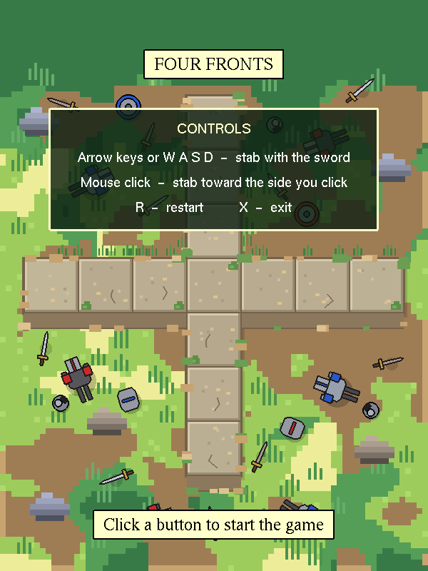

# Four Fronts

A one-life sword-fighting arcade game written in C++ with OpenGL and GLUT for a computer graphics course, based on Fist of Fury.

**[Play it in your browser](https://s-milly.github.io/four-fronts/)**



## How it plays

The hero stands on the center tile of a cross-shaped stone platform. Enemy soldiers march in along the four arms, one tile at a time, and the hero has to stab each one before it reaches him. One hit and the game is over.

- **One enemy per tile number.** If an enemy is on tile 1 of one arm, no other arm can have an enemy on tile 1. That keeps the screen to three enemies at most.
- **Fury meter.** Every knockout is worth 1 point and fills the meter, which slowly drains over time. When it is full, swords fly out in every direction, every enemy on the screen is knocked out, and the game speeds up. A short break follows before new enemies arrive.
- **Drawn in code.** Every shape, from the pixel-art meadow to the swords and the smoke puffs, is drawn with OpenGL primitives. There are no image files.

## Controls

| Key | Action |
|---|---|
| Arrow keys or W A S D | Stab left, right, up, or down |
| Mouse click | Stab toward the side of the screen you click |
| R | Restart |
| X or Escape | Exit |
| T | Show or hide the placeholder labels (development) |
| F | Show speed measurements (development) |

## Build and run

The whole game is one file, `four_fronts.cpp`.

**Linux** (Ubuntu or Debian):

```bash
sudo apt install g++ freeglut3-dev
g++ four_fronts.cpp -o four_fronts -lglut -lGLU -lGL
./four_fronts
```

**Windows** (Visual Studio): create an empty C++ project, add `four_fronts.cpp`, and add freeglut (for example with `vcpkg install freeglut`, or by linking `freeglut.lib`, `opengl32.lib` and `glu32.lib` yourself).

## Browser version

The `web` folder holds a port of the game to the HTML canvas, which is what the play link above runs. It follows the C++ code function by function, so the rules, timing and art are the same. A few things change for the web:

- Tapping a side of the screen stabs that way, so it works on phones.
- X goes back to the title page, since a web page cannot close its own window.
- The development keys (T and F) are left out.
- The best score is remembered between visits.

To run it locally, serve the `web` folder with any static server, for example `python3 -m http.server --directory web`, and open the address it prints.
